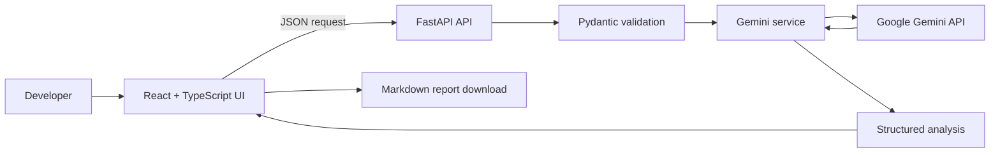

# FixProof AI

**AI-assisted code debugging for Python and JavaScript, powered by Google Gemini.**

FixProof AI reviews source code as text, explains likely issues and root causes, proposes fixes, and creates suggested tests. **Submitted code is not executed.** AI findings are estimates and must be reviewed by a developer.

## Live application

- Frontend: https://fixproof-ai-frontend.onrender.com/
- API health: https://fixproof-ai-api.onrender.com/health
- Source code: https://github.com/Nikki03-tech/FixProofAI

The deployed URLs should be checked after each Render deployment. The health endpoint confirms that the API process responds; it does not validate Gemini credentials or make a Gemini request.

## Features

- Python and JavaScript source-code analysis
- Beginner, intermediate, and advanced explanations
- Potential issue list and likely root cause
- Severity classification and AI confidence estimate
- Suggested code fixes and test cases
- Actionable verification checklist
- Downloadable Markdown report
- API health indicator in the frontend
- Request validation, request-size guard, and per-instance analysis rate limiting

## Architecture



### Stack

| Layer | Technology |
|---|---|
| Frontend | React 18, TypeScript, Vite |
| Backend | Python, FastAPI, Pydantic |
| AI | Google Gemini API |
| HTTP client | HTTPX |
| Tests | Pytest, FastAPI TestClient, GitHub Actions |
| Hosting | Render |

## Local setup

### Backend

From the repository root:

```bash
python -m venv .venv
# Activate the virtual environment
pip install -r Backend/requirements.txt
```

Create `Backend/.env` using `Backend/.env.example` as a reference:

```env
GEMINI_API_KEY=your_gemini_api_key
GEMINI_MODEL=gemini-3.5-flash-lite
FRONTEND_ORIGIN=http://localhost:5173
MAX_CODE_LENGTH=20000
REQUEST_TIMEOUT=90
ANALYZE_RATE_LIMIT_PER_MINUTE=5
```

Run the API from the repository root:

```bash
uvicorn Backend.main:app --reload --host 0.0.0.0 --port 8000
```

### Frontend

In another terminal:

```bash
cd frontend
npm install
```

Create `frontend/.env`:

```env
VITE_API_BASE_URL=http://localhost:8000
```

Start the frontend:

```bash
npm run dev
```

Open the local Vite URL, normally `http://localhost:5173`.

## Tests and build

Run backend tests from the repository root:

```bash
python -m pytest Backend/tests -q
```

Build the frontend:

```bash
cd frontend
npm install
npm run build
```

GitHub Actions runs backend tests and the frontend production build on pushes and pull requests to `main`.

## API

| Method | Endpoint | Purpose |
|---|---|---|
| GET | `/health` | API process health |
| POST | `/api/analyze` | Gemini-powered source analysis |
| POST | `/api/report` | Generate Markdown report |

Example analysis request:

```json
{
  "code": "def average(numbers): return sum(numbers) / len(number)",
  "language": "python",
  "explanation_level": "beginner",
  "include_tests": true
}
```

## Deployment on Render

The root `render.yaml` defines two services:

1. `fixproof-ai-api`: FastAPI service using `Backend/requirements.txt`, Uvicorn, and `/health`.
2. `fixproof-ai-frontend`: Vite static site published from `frontend/dist`.

Set `GEMINI_API_KEY` as a secret in the backend Render environment. Do not commit it or place it in a frontend `VITE_*` variable. Keep the frontend `VITE_API_BASE_URL` and backend `FRONTEND_ORIGIN` aligned with the actual public service URLs.

## Security and limitations

- The backend does not execute submitted source code.
- Analysis requests have a configurable code-character limit.
- API analysis requests have a per-process fixed-window rate limit (default: 5 per minute).
- Request bodies with a declared Content-Length above the configured guard are rejected.
- The in-memory limiter is intended as a basic single-instance safeguard. Multiple instances require a shared rate-limit store such as Redis.
- A Content-Length guard is not a substitute for edge/proxy request-size enforcement.
- Never submit API keys, passwords, tokens, or private customer data.
- Gemini output, severity, and confidence are AI-generated estimates, not guarantees. Review suggestions and run tests in a safe environment before applying changes.

## Alternative interface

A Streamlit interface is also available from the root-level `app.py`. Configure the same Gemini environment variables, install root `requirements.txt`, and run:

```bash
streamlit run app.py
```
