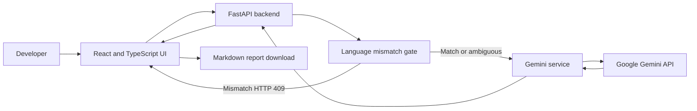

# FixProof AI

**AI-assisted code debugging for Python and JavaScript, powered by Google Gemini.**

FixProof AI reviews source code as text, explains likely issues and root causes, proposes fixes, and creates suggested tests. **Submitted code is not executed.** AI findings are estimates and must be reviewed by a developer.

## Live application

- **Main application:** https://fixproofai.onrender.com/
- **Source code:** https://github.com/Nikki03-tech/FixProofAI

## Features

- Python and JavaScript source-code analysis
- Language mismatch detection before AI analysis; mismatch stops the request until the user switches language
- Beginner, intermediate, and advanced explanations
- Potential issue list and likely root cause
- Severity classification and AI confidence estimate
- Suggested code fixes and test cases
- Actionable verification checklist
- Downloadable Markdown report
- API health indicator
- Request validation, request-size guard, and per-instance analysis rate limiting
- Black-and-gold interface

## Architecture documentation

Professional design documents are available in the `docs/` folder:

- [High-Level Design (HLD)](docs/HLD.md) — system context, architecture, components, major flows, deployment, security boundaries, and limitations.
- [Low-Level Design (LLD)](docs/LLD.md) — module responsibilities, language-detection algorithm, API contracts, frontend state machine, error handling, configuration, and test strategy.

The architecture and sequence diagrams use Mermaid and render directly on GitHub.

## Architecture overview



## Technology stack

| Layer | Technology |
|---|---|
| Frontend | React 18, TypeScript, Vite |
| Backend | Python, FastAPI, Pydantic |
| AI | Google Gemini API |
| HTTP client | HTTPX |
| Tests | Pytest, FastAPI TestClient, GitHub Actions |
| Hosting | Render |

## Language mismatch workflow

1. The user selects a programming language, pastes code, and selects Analyze.
2. The backend checks clear language signals before invoking Gemini.
3. If the language differs from the selection, the API returns HTTP 409 with `detail.code = LANGUAGE_MISMATCH`. No Gemini request is made.
4. The frontend shows only the mismatch panel. Findings and report panels remain hidden.
5. The user selects **Switch to [detected language] and analyze**. The frontend updates the selector and sends a fresh request.
6. If a snippet is too short or ambiguous to classify, the selected language is used.

## Local setup

### Backend

From the repository root:

```bash
python -m venv .venv
# Activate the virtual environment
pip install -r Backend/requirements.txt
```

Create `Backend/.env` using `Backend/.env.example` as a reference:

```env
GEMINI_API_KEY=your_gemini_api_key
GEMINI_MODEL=gemini-3.5-flash-lite
FRONTEND_ORIGIN=http://localhost:5173
MAX_CODE_LENGTH=20000
REQUEST_TIMEOUT=90
ANALYZE_RATE_LIMIT_PER_MINUTE=5
```

Start FastAPI from the repository root:

```bash
uvicorn Backend.main:app --reload --host 0.0.0.0 --port 8000
```

### Frontend

In another terminal:

```bash
cd frontend
npm install
```

Create `frontend/.env`:

```env
VITE_API_BASE_URL=http://localhost:8000
```

Start Vite:

```bash
npm run dev
```

Open the local URL printed by Vite (normally `http://localhost:5173`).

## Tests and build

Run backend tests from the repository root:

```bash
python -m pytest Backend/tests -q
```

Build the frontend:

```bash
cd frontend
npm install
npm run build
```

GitHub Actions runs backend tests and the frontend production build on pushes and pull requests to `main`.

## API endpoints

| Method | Endpoint | Purpose |
|---|---|---|
| GET | `/health` | API process health |
| POST | `/api/analyze` | Language gate followed by Gemini analysis |
| POST | `/api/report` | Generate Markdown from a successful analysis |

A mismatch returns HTTP 409 with `detail.code = LANGUAGE_MISMATCH`; it is a control response, not an analysis result.

## Render deployment

The root `render.yaml` contains the backend and frontend service definitions. The project owner's public application URL is:

**https://fixproofai.onrender.com/**

Set `GEMINI_API_KEY` as a secret in the backend Render environment. Never commit it or put it in a frontend `VITE_*` variable. Confirm the actual backend service URL in the Render dashboard and set the frontend's `VITE_API_BASE_URL` to that exact address. The backend's `FRONTEND_ORIGIN` must match the frontend's public origin.

Deploy the frontend and backend together when publishing changes to the HTTP 409 mismatch contract.

## Security and limitations

- The backend does not execute submitted source code.
- Analysis requests have a configurable code-character limit.
- Analysis requests have a per-process fixed-window rate limit (default: 5 per minute).
- A Content-Length guard rejects requests declaring a body above its limit; proxy/edge enforcement is also recommended.
- The in-memory rate limiter is a basic single-instance safeguard; multiple instances need a shared store such as Redis.
- Language detection is heuristic and returns unknown for ambiguous snippets.
- Never submit API keys, passwords, access tokens, or private customer data.
- Gemini findings, severity, and confidence are estimates, not guarantees. Review suggestions and run tests before using changes.

## Alternative interface

A Streamlit interface is available from the root-level `app.py`. Configure the same Gemini environment variables, install root `requirements.txt`, and run:

```bash
streamlit run app.py
```
