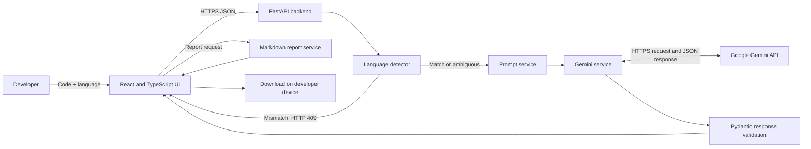
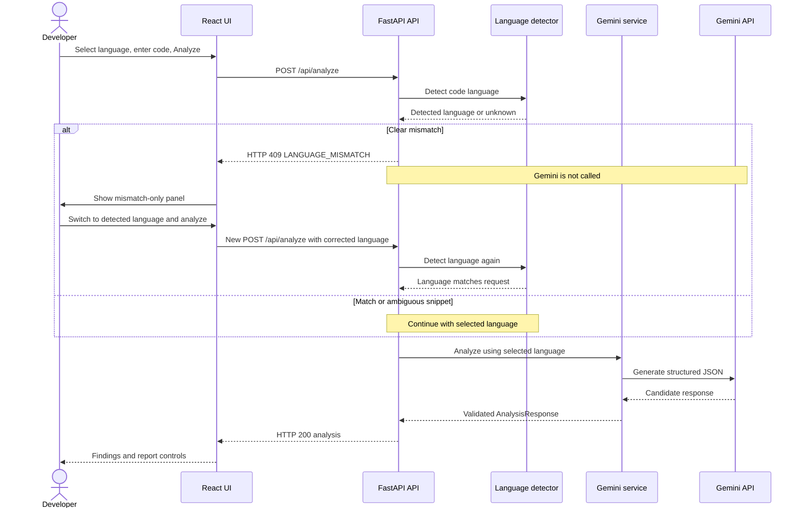
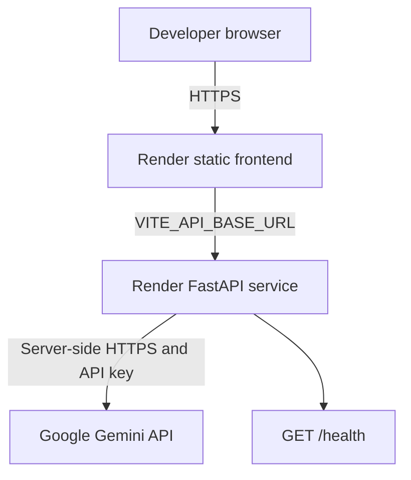

# FixProof AI — High-Level Design (HLD)

**Document:** System Architecture / High-Level Design  
**Version:** 1.0  
**Status:** Current implementation  
**Application:** FixProof AI

## 1. Purpose and scope

FixProof AI is a browser-based debugging assistant for Python and JavaScript. It sends source code as text to Google Gemini and displays structured findings: summary, potential issues, likely root cause, suggested fixes, test suggestions, severity, confidence estimate, verification checklist, and limitations.

The backend does not compile or execute submitted code.

### Goals

- Provide a simple source-code analysis workflow.
- Support Python and JavaScript.
- Detect clear language-selector mismatches before invoking Gemini.
- Keep Gemini credentials on the backend.
- Provide downloadable Markdown reports.
- Preserve responsive UI and accessible error states.

### Non-goals

- Executing, compiling, or sandboxing submitted programs.
- Guaranteeing AI correctness.
- Replacing IDE diagnostics, static analyzers, vulnerability scanners, or human code review.
- Supporting more languages without a designed extension.

## 2. System context

## 3. Main components

| Component | Responsibility |
|---|---|
| React + TypeScript frontend | Editor, language selector, request status, mismatch gate, analysis view, report download |
| FastAPI backend | API endpoints, validation, rate limiting, language gate and error responses |
| Language detector | Heuristic Python/JavaScript classification |
| Prompt service | Safe, structured prompt creation |
| Gemini service | Server-side Gemini request and response validation |
| Report service | Converts analysis data to Markdown |
| Render | Hosts frontend and backend services |

## 4. Analysis sequence

## 5. Language mismatch as a hard gate

A mismatch is a control-flow response, not an analysis result.

- A clear mismatch returns HTTP 409 and `detail.code = LANGUAGE_MISMATCH`.
- The response contains selected language, detected language, and a display message.
- The FastAPI route exits before calling `analyze_code`.
- The frontend renders a dedicated mismatch panel instead of the analysis and report panels.
- The user action updates the selector and submits a new analysis request.
- If source is short or ambiguous, detection returns unknown and the selected language remains authoritative.

## 6. Deployment architecture

The project owner’s public application URL is documented in the repository README. The backend service URL must be taken from the Render dashboard and configured as `VITE_API_BASE_URL`. The backend’s `FRONTEND_ORIGIN` must match the actual public frontend origin.

## 7. Security and trust boundaries

- Gemini API key is stored in backend environment variables and never exposed in frontend build variables.
- Submitted source code is sent to Gemini for analysis; do not paste passwords, tokens, API keys, or personal/private data.
- No submitted code is executed.
- Pydantic validates request shape, language and code length.
- A Content-Length guard rejects declared oversized requests.
- Analysis uses a per-process in-memory fixed-window rate limit. A shared store is required for distributed limits.
- Severity and confidence are AI-generated estimates and do not establish correctness.

## 8. Operational endpoints

| Method | Endpoint | Description |
|---|---|---|
| GET | `/health` | API process health |
| POST | `/api/analyze` | Language gate, then Gemini analysis if permitted |
| POST | `/api/report` | Generate Markdown from a successful analysis |

## 9. Key limitations

- Regex-based language detection cannot perfectly classify every snippet.
- The in-memory rate limiter resets on process restart and is not shared across instances.
- The request-size guard is based on declared Content-Length; proxy/edge enforcement is also recommended.
- `/health` verifies process responsiveness, not Gemini credentials or upstream availability.
- AI findings must be reviewed and tested by a developer.
