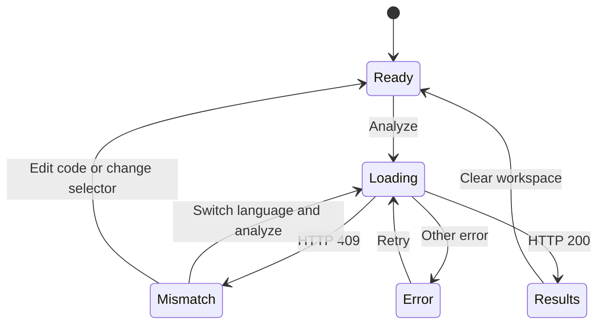

# FixProof AI — Low-Level Design (LLD)

**Document:** Component / Low-Level Design  
**Version:** 1.0  
**Status:** Current implementation  
**Application:** FixProof AI

## 1. Repository structure

```text
FixProofAI/
├── Backend/
│   ├── main.py
│   ├── config.py
│   ├── schemas.py
│   ├── services/
│   │   ├── ai_service.py
│   │   ├── language_detection.py
│   │   ├── prompt_service.py
│   │   └── report_service.py
│   └── tests/
│       ├── test_ai_service.py
│       ├── test_api_security.py
│       ├── test_language_api.py
│       ├── test_language_detection.py
│       └── test_reports.py
├── frontend/src/
│   ├── components/
│   │   ├── AnalysisPanel.tsx
│   │   ├── CodeEditor.tsx
│   │   ├── Header.tsx
│   │   ├── LanguageMismatchPanel.tsx
│   │   └── ReportPanel.tsx
│   ├── services/api.ts
│   ├── types.ts
│   ├── App.tsx
│   └── styles.css
├── docs/
│   ├── HLD.md
│   └── LLD.md
├── .github/workflows/ci.yml
├── render.yaml
└── README.md
```

## 2. Backend module responsibilities

### `Backend/main.py`

- Creates the FastAPI application and CORS policy.
- Applies request-size and analysis rate-limit middleware.
- Exposes health, analysis, and report endpoints.
- Detects a clear language mismatch and returns HTTP 409 before the Gemini service.
- Maps Gemini service failures to HTTP 502.

### `Backend/services/language_detection.py`

The detector uses weighted regular-expression evidence.

| Python indicators | JavaScript indicators |
|---|---|
| `def name(...):` | `const`, `let`, `var` |
| Python colon-based blocks | `console.log/error/warn` |
| `None`, `True`, `False`, `self`, `lambda` | Arrow function `=>` |
| `print(` | `function name(` |
| Python imports | `undefined`, `null`, `this`, `export` |
| Indented statements | Semicolon-based line endings |

For each language, the detector sums pattern weights multiplied by the number of matches. It returns a language only if its score is at least 2 and exceeds the alternative score by at least 2. Otherwise it returns `None`, and the selected language is used.

### `Backend/services/ai_service.py`

- Reads backend-only `GEMINI_API_KEY`, `GEMINI_MODEL`, and `REQUEST_TIMEOUT`.
- Calls Gemini via HTTPX.
- Parses the candidate JSON and validates it against `AnalysisResponse`.
- Converts timeout, network, upstream HTTP and invalid-payload errors into `AIServiceError`.
- Does not execute submitted source.

### `Backend/services/prompt_service.py`

Creates the prompt using source text, selected language, explanation level, test preference, required JSON keys, and untrusted-input instructions.

### `Backend/services/report_service.py`

Builds a Markdown report containing language, explanation level, non-execution notice, severity, confidence, findings, root cause, verification checklist, fixes, tests, and limitations.

## 3. API contract

### Analysis request — `POST /api/analyze`

```json
{
  "code": "def greet(name):\n    print('hello', name)",
  "language": "javascript",
  "explanation_level": "beginner",
  "include_tests": true
}
```

### Language mismatch — HTTP 409

```json
{
  "detail": {
    "code": "LANGUAGE_MISMATCH",
    "selected_language": "javascript",
    "detected_language": "python",
    "message": "You selected javascript, but the code looks like python. Switch the language and analyze again."
  }
}
```

This is not an analysis object. It must not contain AI findings. The backend must not call the Gemini service in this branch.

### Successful analysis — HTTP 200

Returns `AnalysisResponse` with `success`, `summary`, `issues`, `root_cause`, `severity`, `confidence`, `verification_steps`, `suggested_fixes`, `tests`, and `limitations`.

### Report request — `POST /api/report`

Contains the analysis request and its successful result. Returns `{"report": "<markdown>"}`.

## 4. Frontend design

### Application state

| State | Type | Function |
|---|---|---|
| `code` | string | Current editor text |
| `language` | SupportedLanguage | Dropdown value |
| `result` | AnalysisResponse or null | Successful analysis only |
| `lastRequest` | AnalysisRequest or null | Request associated with accepted result |
| `languageMismatch` | LanguageMismatchError or null | Blocking mismatch state |
| `isLoading` | boolean | Request progress |
| `error` | string | Non-mismatch failure message |

### UI state machine



The mismatch state takes precedence over all result panels. The switch action sets the detected language and makes a new API call using that language. Only a successful HTTP 200 response may populate the result and report states.

### `frontend/src/services/api.ts`

- Resolves the backend URL from `VITE_API_BASE_URL`.
- Converts HTTP 409 `LANGUAGE_MISMATCH` to a typed `LanguageMismatchError`.
- Maps connectivity, rate-limit, size and server errors to user-friendly messages.
- Exposes health, analyze and report functions.

### `LanguageMismatchPanel.tsx`

Displays the selected and detected languages, an analysis-paused message, and a single action: switch to the detected language and analyze. It contains no findings, explanation, or report download.

### `AnalysisPanel.tsx` and `ReportPanel.tsx`

Render only after a successful analysis response. They do not handle language mismatch.

## 5. Error handling

| Condition | Backend response | Frontend behavior |
|---|---|---|
| Empty code | Request validation error | Ask the user to enter code |
| Code exceeds max length | HTTP 422 | Show validation message |
| Declared request too large | HTTP 413 | Ask for smaller input |
| Rate limit reached | HTTP 429 | Ask the user to wait |
| Language mismatch | HTTP 409 | Mismatch-only state; Gemini is not called |
| Gemini error | HTTP 502 | Show error and retry |
| Valid analysis | HTTP 200 | Render findings and report |

## 6. Test strategy

- Detector tests: Python, JavaScript, and ambiguous source.
- API gate test: mismatch returns HTTP 409; a patched Gemini function raises if called, proving the route exits before analysis.
- API success test: corrected language allows the service to be called.
- Gemini tests: missing key, valid JSON, malformed JSON, upstream HTTP error, timeout.
- Security tests: rate limit and input-size/code validation.
- Report tests: severity, confidence, and verification content.
- CI: backend pytest suite and frontend TypeScript/Vite build.

## 7. Configuration

| Environment variable | Component | Description |
|---|---|---|
| `GEMINI_API_KEY` | Backend | Secret key |
| `GEMINI_MODEL` | Backend | Gemini model name |
| `REQUEST_TIMEOUT` | Backend | Gemini HTTP timeout |
| `MAX_CODE_LENGTH` | Backend | Source code character ceiling |
| `ANALYZE_RATE_LIMIT_PER_MINUTE` | Backend | Per-instance analysis limit |
| `FRONTEND_ORIGIN` | Backend | CORS origin |
| `VITE_API_BASE_URL` | Frontend | FastAPI base URL |

## 8. Security notes and limitations

- Source code is transmitted to Gemini for analysis; never submit secrets.
- The backend does not execute submitted code.
- In-memory rate limiting is process-local, not a distributed quota.
- Content-Length checking should be complemented by proxy or platform body-size limits.
- Detection is heuristic and does not replace a language parser.
- AI findings are estimates and require developer verification.

## 9. Deployment compatibility

The backend and frontend must be released together because the mismatch contract uses HTTP 409. Verify the live deployment by selecting JavaScript, submitting unambiguous Python source, confirming that only the mismatch panel appears, then selecting **Switch to Python and analyze** and confirming a fresh successful analysis.
